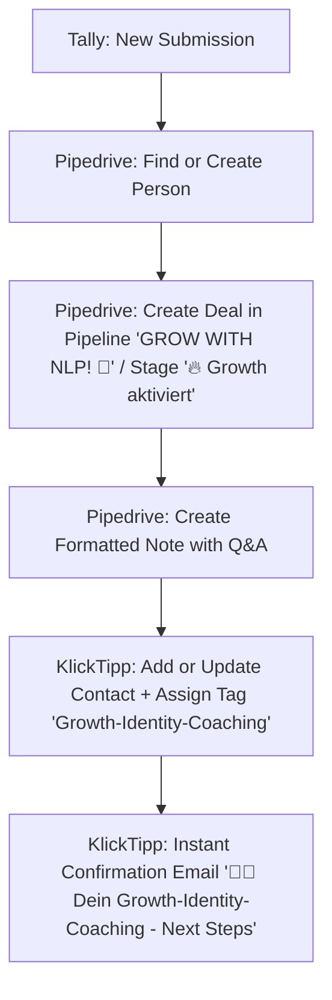

# Automations-Spezifikation: Tally → Zapier → Pipedrive & KlickTipp

**Projekt:** Marcel Rosenbach (`deep-nlp.com`) · Funnel: Growth-Identity-Coaching  
**Auslöser:** Neue Bewerbung im Tally-Formular `Deine Chance auf ein persönliches Money-Coaching`  
**Systeme:**
- **Zapier:** Account Marcel (`mr@marcel-rosenbach.de`)
- **Pipedrive:** `marcelrosenbachfzco`
- **KlickTipp:** Account `341498`
- **Tally:** Formular `Deine Chance auf ein persönliches Money-Coaching`

---

## 1. Übersicht des Zap-Ablaufs



---

## 2. Detaillierte Schritt-Konfiguration im Zap

### Schritt 1: Trigger (Tally)
- **App:** Tally
- **Event:** `New Response in Form`
- **Form:** `Deine Chance auf ein persönliches Money-Coaching`
- **Output-Payload:**
  - `fields.first_name` (Vorname)
  - `fields.last_name` (Nachname)
  - `fields.email` (E-Mail)
  - `fields.phone` (Telefon)
  - `fields.q1_situation` (Situation)
  - `fields.q2_income` (Einkommensziel)
  - `fields.q3_obstacles` (Hindernisse, Array / kommagetrennt)
  - `fields.q4_life_change` (Freitext Veränderung)
  - `fields.q5_readiness` (Veränderungsbereitschaft)
  - `submitted_at` (Zeitstempel)

---

### Schritt 2: Pipedrive – Person suchen oder anlegen (Find or Create Person)
- **App:** Pipedrive
- **Event:** `Find Person` (mit aktiviertem `Create Pipedrive Person if it doesn't exist yet?`)
- **Search Field:** `Email` &rarr; Wert: `{{1. fields.email}}`
- **Create Person Fields:**
  - **First Name:** `{{1. fields.first_name}}`
  - **Last Name:** `{{1. fields.last_name}}`
  - **Email:** `{{1. fields.email}}` (Work/Primary)
  - **Phone:** `{{1. fields.phone}}` (Mobile/Primary)
- **WICHTIGE REGEL (Incident-Schutz):** Niemals Vor- und Nachname in ein gemeinsames Feld "Person Name" schreiben, da dies in der Pipedrive API zu einem 400 Bad Request führt!

---

### Schritt 3: Pipedrive – Deal anlegen (Create Deal)
- **App:** Pipedrive
- **Event:** `Create Deal`
- **Title:** `{{1. fields.first_name}} {{1. fields.last_name}} 💸GROWTH-COACHING`
- **Pipeline:** `GROW WITH NLP! 🤯`
- **Stage:** `🔥 Growth aktiviert` (3. Phase in der Pipeline)
- **Person:** `{{2. ID}}` (aus Schritt 2)
- **Status:** `Open`
- **Expected Close Date:** `+14 days` (optional)

---

### Schritt 4: Pipedrive – Übersichtliche Notiz erstellen (Create Note)
- **App:** Pipedrive
- **Event:** `Create Note`
- **Deal ID:** `{{3. ID}}` (aus Schritt 3)
- **Person ID:** `{{2. ID}}`
- **Pinned to Deal:** `True`
- **Content (Exakte Formatierung mit Freizeilen):**

```text
1. Welche Situation beschreibt Dich aktuell am besten?
{{1. fields.q1_situation}}

2. Welches monatliche Einkommen oder welchen Umsatz möchtest Du in den nächsten 12 Monaten erreichen?
{{1. fields.q2_income}}

3. Was hält Dich aktuell am stärksten davon ab, finanziell mehr zu erreichen? Kreuze gern mehrere Punkte an!
{{1. fields.q3_obstacles_formatted}}

4. Wenn Du Dein Einkommen verdoppeln würdest: Was würde sich dadurch konkret in Deinem Leben verändern? Notiere 2-3 Punkte.
{{1. fields.q4_life_change}}

5. Wie bereit bist Du, Deine bisherigen Denk- und Verhaltensmuster rund um Geld aktiv zu verändern?
{{1. fields.q5_readiness}}

---
Bewerber-Details:
Name: {{1. fields.first_name}} {{1. fields.last_name}}
E-Mail: {{1. fields.email}}
Telefon: {{1. fields.phone}}
Eingereicht am: {{1. submitted_at}}
```
*Hinweis zur Mehrfachauswahl (Frage 3):* Falls Tally die Optionen kommagetrennt übergibt, wird ein kurzes Zapier-Formatter-Element (Line-Break-Replace) oder Textausgabe genutzt, damit jede Antwort auf einer eigenen Zeile steht.

---

### Schritt 5: KlickTipp – Kontakt anlegen / aktualisieren (Add or Update Contact)
- **App:** KlickTipp
- **Event:** `Add or Update Contact`
- **Account:** Marcel Rosenbach (`341498`)
- **E-Mail:** `{{1. fields.email}}` (Primärschlüssel für Deduplizierung)
- **Vorname:** `{{1. fields.first_name}}`
- **Nachname:** `{{1. fields.last_name}}`
- **Mobiltelefon:** `{{1. fields.phone}}`
- **Tag:** `Growth-Identity-Coaching`
  - **ACHTUNG:** Das Tag muss als echtes **Tag** in KlickTipp angelegt sein, NICHT als "Label" (verhindert den bekannten `[406] Tag not found` Fehler).

---

### Schritt 6: KlickTipp – Sofortige Bestätigungs-E-Mail auslösen
- **Versand-Auslöser:** Kontakt erhält das Tag `Growth-Identity-Coaching`
- **Absender:** `Marcel Rosenbach <kontakt@marcel-rosenbach.de>`
- **Betreff:** `🙌🏼 Dein Growth-Identity-Coaching - Next Steps`
- **Personalisierung:** `[[Vorname]]`
- **Keine Follow-Up-Serie:** Es wird genau **eine** E-Mail verschickt (keine 5-Tage-Sequenz).

#### Vollständiger E-Mail-Text (1:1 aus MMM-Referenztexte.md):

```text
BETREFF: 🙌🏼 Dein Growth-Identity-Coaching - Next Steps

Hey [[Vorname]],

👍🏽 YES! Deine Bewerbung für Dein persönliches Growth-Identity-Coaching ist angekommen!

Ich freue mich, dass Du Dein finanzielles Wachstum aktiv angehen möchtest.

Stell Dir einmal vor:

Du würdest in den nächsten Monaten nicht einfach nur härter oder mehr arbeiten, sondern endlich die mentalen Knoten lösen, die Dich finanziell bremsen.

Vielleicht werden wir zusammen…

💭 Deine Geld-Glaubenssätze hinterfragen und verändern.
🏆 Dich und Deine Leistung selbstbewusster verkaufen.
🙌🏼 konsequent mehr Money-Making-Activities umsetzen.
🤯 größer über Dein Einkommen und Deine Möglichkeiten denken.
🏁 neue finanzielle Ziele mit einem Handlungsplan verknüpfen.

Genau daran können wir im Growth-Identity-Coaching gemeinsam arbeiten.

Und vielleicht ist das der Anfang eines völlig neuen finanziellen Kapitels für Dich.

Wie geht es weiter?

Ich vergebe nur eine begrenzte Anzahl persönlicher 1:1-Coachings.

Deshalb werden die Bewerbungen individuell geprüft.

Wenn Du für einen der Coaching-Plätze infrage kommst, melden mein Team oder ich uns persönlich bei Dir.

Bis dahin habe ich eine Aufgabe für Dich:

💸 Starte direkt mit Make More Money, Baby!

Achte beim Kurs besonders darauf, welche Gedanken Du über Geld hast und welche finanziell wichtigen Aktivitäten Du bisher vermeidest.

Das könnte bereits eine spannende Vorbereitung für unser mögliches Coaching sein.

Ich freue mich auf Dein nächstes Money-Level!

Dein NLP Trainer,  
Marcel Rosenbach 🙋🏼‍♂️

Noch eine Frage zum Nachdenken: Wenn Du ab morgen doppelt so viel verdienen würdest. Was würdest Du in Deinem Leben als Erstes verändern?
```

---

## 3. Begleitende Anpassung im bestehenden MMM-Zap

Für normale Anmeldungen über das bestehende Formular `7RaKgP` (Make More Money Basiskurs):
- **Bestehender KlickTipp-Tag:** `MAKE MORE MONEY, BABY` (bereits vorhanden).
- **Pipedrive-Deal-Titel:** Im bestehenden Zap anpassen auf:  
  `{{fields.first_name}} {{fields.last_name}} 🤑MAKE MORE MONEY`
- Bestehende Kurszustellung (z.B. Coachy / Skool) und bestehende E-Mail-Serie bleiben vollständig unangetastet.
